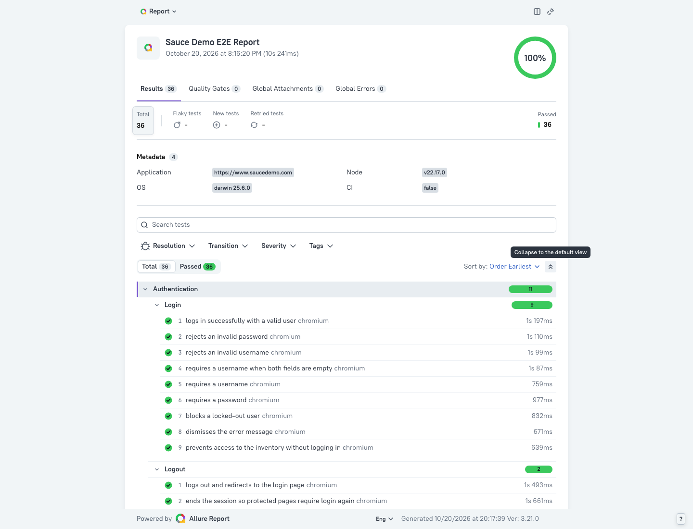
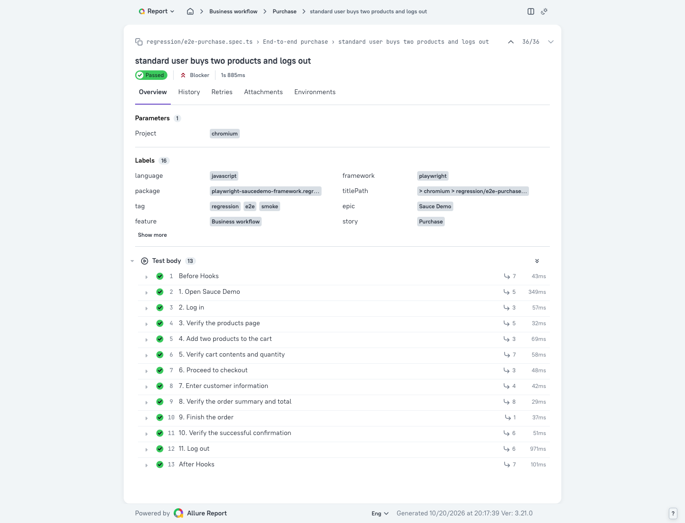
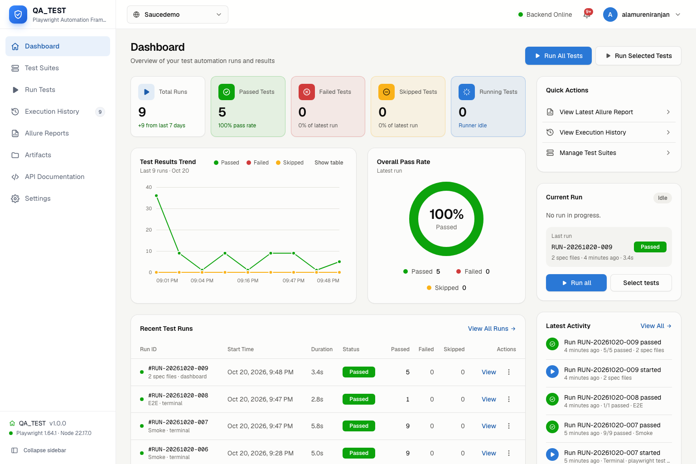

# Sauce Demo E2E Automation Framework

End-to-end test automation for [Sauce Demo](https://www.saucedemo.com/), built with **Playwright**, **TypeScript** and **Allure Report**. It covers authentication, the product catalog, the shopping cart, checkout, and a full purchase workflow, using the Page Object Model and custom Playwright fixtures. A **Next.js dashboard** shows results and runs suites from the browser.

## Technology stack

| Tool | Version | Purpose |
|---|---|---|
| [Playwright Test](https://playwright.dev/) | 1.64.1 (pinned) | Test runner and browser automation |
| TypeScript | 7.x | Strictly typed test code |
| [allure-playwright](https://allurereport.org/docs/playwright/) | 3.x | Writes Allure results during the run |
| [Allure Report](https://allurereport.org/) (`allure` npm package) | 3.x | Generates and serves the HTML report (no Java needed) |
| dotenv | 18.x | Loads optional `.env` overrides |
| Jenkins | - | CI pipeline (`Jenkinsfile`) |
| Next.js + Tailwind CSS | 16 / 4 | Local QA dashboard (`dashboard/`) |

## Prerequisites

- **Node.js 20 or newer** (developed on Node 22) and npm
- Network access to `https://www.saucedemo.com`
- Docker, only if you run the Jenkins pipeline as written

## Installation

```bash
git clone <your-repo-url>
cd playwright-saucedemo-framework
npm ci                      # installs exact versions from package-lock.json
npm run browsers:install    # installs Google Chrome, Firefox and WebKit for Playwright
```

Optional: to run Firefox and WebKit as well, install them with `npx playwright install firefox webkit`.

## Folder structure

```text
playwright-saucedemo-framework/
├── tests/                          # Specs, grouped by feature
│   ├── auth/                       # login.spec.ts, logout.spec.ts
│   ├── products/                   # product-list.spec.ts, product-sort.spec.ts
│   ├── cart/                       # add-to-cart.spec.ts, remove-from-cart.spec.ts
│   ├── checkout/                   # checkout-information.spec.ts, complete-order.spec.ts
│   └── regression/                 # e2e-purchase.spec.ts (full business workflow)
├── pages/                          # Page Object Model
│   ├── BasePage.ts                 # Shared header: cart badge, menu, logout
│   ├── LoginPage.ts
│   ├── ProductsPage.ts             # Inventory list, sorting, add/remove
│   ├── ProductDetailsPage.ts
│   ├── CartPage.ts
│   ├── CheckoutPage.ts             # Step one (information) and step two (overview)
│   └── OrderCompletePage.ts
├── fixtures/test-fixtures.ts       # Page-object fixtures + `loggedInProductsPage`
├── test-data/                      # users.ts, products.ts, customers.ts
├── utils/test-helpers.ts           # Price parsing/formatting, order totals, sorting, Allure labels
├── utils/browser-info.ts           # Tags each test with its browser version (and device OS version)
├── dashboard/                      # Next.js QA dashboard (see dashboard/README.md)
├── docs/screenshots/               # Report screenshots used in this README
├── playwright.config.ts
├── allurerc.mjs                    # Allure 3 report settings (name, tree grouping)
├── tsconfig.json
├── Jenkinsfile
├── .env.example
└── package.json
```

### How the framework fits together

- **Page objects** (`pages/`) own every locator and user action. Specs never use raw selectors. Locators prefer `getByRole` and `getByTestId`. Sauce Demo marks elements with `data-test`, so the config sets `testIdAttribute: 'data-test'`.
- **Fixtures** (`fixtures/test-fixtures.ts`) inject a ready-made page object into each test. `loggedInProductsPage` logs in as the standard user and checks that the Products page loaded, so tests that need a session start in one line. Two automatic fixtures run for every test: `livePreview` streams frames to the dashboard when `LIVE_PREVIEW=1`, and `browserInfo` tags the test with the real browser version (plus the emulated iOS or Android version on devices) as `browser-version` and `os-version` annotations.
- **Test data** (`test-data/`) holds credentials, expected catalog data, error messages and a `createCustomer()` builder that makes unique checkout data for each test.
- **Helpers** (`utils/`) calculate expected totals in integer cents to avoid floating-point rounding errors, and set Allure epic, feature and story labels.
- Each test gets a fresh browser context, so tests share no state and can run in any order or in parallel.

## Environment configuration

Every setting has a working default. To override one, copy the example file:

```bash
cp .env.example .env
```

| Variable | Default | Description |
|---|---|---|
| `BASE_URL` | `https://www.saucedemo.com` | Application under test |
| `SAUCE_STANDARD_USER` | `standard_user` | Valid user |
| `SAUCE_LOCKED_OUT_USER` | `locked_out_user` | Locked-out user |
| `SAUCE_PASSWORD` | `secret_sauce` | Shared password |
| `BROWSERS` | `chrome` | Desktop browsers to run, comma-separated: `chrome` (Google Chrome), `firefox`, `webkit`, or `all`; empty for device-only runs |
| `DEVICES` | none | Emulated phones and tablets (Playwright device profiles): `iphone-17-pro`, `iphone-17-pro-max`, `iphone-16`, `iphone-16e`, `pixel-10-pro`, `pixel-9`, `galaxy-s24`, `galaxy-a55`, `ipad-pro-11`, `ipad-gen-11`, `ipad-mini`, `galaxy-tab-s9`, `galaxy-tab-s4`, or `all`. Apple devices run in WebKit, Android in Chrome. The list lives in `utils/devices.ts` |
| `CROSS_BROWSER` | `false` | `true` is a shortcut for `chrome,firefox,webkit` (ignored when `BROWSERS` is set) |
| `LIVE_PREVIEW` | unset | `1` streams each running test's browser (about 3 frames per second) to `test-results/live-frames/` for the dashboard's Live preview |
| `RECORDING_RESOLUTION` | `1080p` | Browser size (viewport), and the size of failed tests' screenshots and videos: `720p` (1280×720), `1080p` (1920×1080) or `1440p` (2560×1440, 2K) |
| `KEEP_ALLURE_RESULTS` | unset | `true` keeps previous `allure-results` instead of clearing them |
| `CI` | unset | Enables CI mode: 2 retries, 2 workers, `forbidOnly`, JUnit output |

The default credentials are the public demo accounts shown on the Sauce Demo login page. They are not secrets. `.env` is git-ignored.

## Running tests

| Command | What it does |
|---|---|
| `npm test` | Runs every test (Google Chrome) |
| `npm run test:headed` | Runs with a visible browser |
| `npm run test:debug` | Opens the Playwright Inspector and steps through tests |
| `npm run test:ui` | Opens Playwright UI mode |
| `npm run test:smoke` | Runs only tests tagged `@smoke` |
| `npm run test:regression` | Runs tests tagged `@regression` (the full suite) |
| `npm run test:e2e` | Runs the end-to-end purchase workflow |
| `npm run test:chrome` | Runs the Google Chrome project only |
| `npm run typecheck` | Type-checks the whole project with `tsc` |
| `npm run dashboard` | Starts the QA dashboard at http://127.0.0.1:3000 (run `npm run dashboard:install` once first) |

Extra Playwright CLI arguments go after `--`:

```bash
npm test -- tests/cart                          # one folder
npm test -- -g "locked-out"                     # by title
npm run test:headed -- --grep @e2e              # headed, one tag
BROWSERS=chrome,firefox npm run test:smoke     # any combination of browsers
BROWSERS= DEVICES=iphone-17-pro,pixel-10-pro npm run test:smoke   # emulated phones only
CROSS_BROWSER=true npm test                     # Chrome + Firefox + WebKit
npm test -- --trace on                          # record traces for every test
```

### Tags

| Tag | Meaning |
|---|---|
| `@smoke` | Fast, critical-path checks (9 tests) |
| `@regression` | Every test (36 tests) |
| `@e2e` | The full purchase workflow |

## Reports

### Allure Report

Each run starts by clearing `allure-results/`, then writes fresh results to it. To build and view the report:

```bash
npm run allure:generate     # allure-results/ -> allure-report/
npm run allure:open         # serves allure-report/ on a local port and opens the browser
```

`allure open` serves the report over HTTP because opening `allure-report/index.html` directly from the file system doesn't work in most browsers.

What the report includes:

- Tests grouped **Feature → Story** (for example Authentication → Login), with suite and tag labels
- Every `test.step()` as a nested step, including fixture setup and teardown
- Status, duration, severity, error message and stack trace
- For failed tests only: the full video of the whole scenario and a full-page PNG screenshot of the moment it failed, at 1080p (or 2K with `RECORDING_RESOLUTION=1440p`). Passed tests keep no media. No trace unless you run with `--trace on`
- Environment metadata: application URL, Node version, OS and CI flag

### Playwright HTML report

```bash
npm run report:playwright
```

### Sample report screenshots

Overview, grouped by feature and story:



The end-to-end test with its numbered business steps:



## QA dashboard

`dashboard/` is a Next.js + Tailwind CSS admin panel that connects to this framework. A collapsible sidebar leads to five pages: **Dashboard** (KPIs, trends, latest run, failing tests), **Test runs** (launch a suite and follow it live with a progress bar and console), **Test history** (every run, filterable, with each run's failures), **Test explorer** (steps, errors, screenshots and videos for each test) and **Reports** (embedded Allure and Playwright reports). It supports light and dark themes and works on mobile.

```bash
npm run dashboard:install   # once
npm run dashboard           # http://127.0.0.1:3000
```



It reads `test-results/results.json` (written by the `json` reporter), so runs started from the terminal appear too. See [dashboard/README.md](dashboard/README.md) for the API and security notes. The dashboard is a local tool: it binds to `127.0.0.1` and can only run this project's fixed npm scripts.

## Implemented scenarios

**Authentication (11)**: valid login; invalid username; invalid password; empty fields; missing username; missing password; locked-out user; dismissing the error message; blocking direct access to the inventory without a session; logout redirects to login; logout ends the session.

**Products (9)**: products page after login; product names, prices and count; product details navigation and return; add to cart from the details page; add and remove on the inventory page; sort by name A–Z and Z–A; sort by price low–high and high–low.

**Shopping cart (6)**: add one product; add multiple products, checking badge count, names, prices and quantities; cart persists across navigation; remove one of several products; remove the last product; continue shopping and re-add.

**Checkout (9)**: cart to checkout navigation; missing first name, last name and postal code; empty form; valid information reaches the overview; cancel returns to the cart; item total, 8% tax and final price; order completion and confirmation message; Back Home with an empty cart.

**End-to-end workflow (1)**: open site → log in → verify products → add two products → verify cart → checkout → enter customer info → verify summary and totals → finish → verify confirmation → log out.

## Jenkins

The `Jenkinsfile` runs inside the official `mcr.microsoft.com/playwright:v1.64.1-noble` image, so the browsers match the pinned Playwright version. Its stages are: checkout → `npm ci` → `playwright install --with-deps chrome` → type check → tests. The agent runs as root (`-u root`) because Google Chrome installs system-wide. A `SUITE` parameter selects `all`, `smoke` or `regression`.

- Test failures mark the build **UNSTABLE** instead of aborting it, so the `post { always { … } }` block still generates the Allure report, publishes JUnit results, and archives `allure-results/`, `allure-report/`, `playwright-report/` and `test-results/`.
- **Required plugins:** Pipeline, Docker Pipeline, JUnit, HTML Publisher, Timestamper.
- **Optional:** Allure Jenkins Plugin with an Allure 2 commandline tool named `allure`, for native trend graphs. Uncomment the `allure` step at the end of the `Jenkinsfile`.
- Store any credential overrides as Jenkins credentials, not in the repository. The `Jenkinsfile` includes a commented example.

When you upgrade `@playwright/test`, update the Docker image tag to the same version.

## Troubleshooting

| Symptom | Fix |
|---|---|
| `browserType.launch: Executable doesn't exist` | Run `npm run browsers:install` (or `npx playwright install firefox webkit` for cross-browser runs). |
| `allure: command not found` | Run `npm ci`. The scripts use the locally installed `allure` package, not a global one. |
| Allure report is empty or shows old tests | Run the tests before `allure:generate`. Results are cleared at the start of every run unless `KEEP_ALLURE_RESULTS=true`. |
| Allure report shows a blank page when opened from disk | Use `npm run allure:open`, which serves the report over HTTP. |
| Allure report in Jenkins (HTML Publisher) is blank | Jenkins' default Content Security Policy blocks report scripts. Download the archived `allure-report/` artifact, relax the CSP for the HTML Publisher, or use the Allure Jenkins Plugin. |
| Using `--reporter=…` produces no Allure results | The CLI flag replaces every configured reporter. Add it back explicitly: `--reporter=list,allure-playwright`. |
| Timeouts on a slow network | Increase `timeout`, `expect.timeout` or `navigationTimeout` in `playwright.config.ts`. |
| No trace in a failure | Traces are off: failed tests keep only a screenshot and a video. Run `npm test -- --trace on` when you need one. |
| No screenshot or video for a passed test | By design: only failed tests keep media. |

## Known limitations

- Sauce Demo is a public demo site with no API or database, so all setup goes through the UI, including login for each test. The full suite still runs in about 10 seconds.
- Expected catalog data (names, prices, 8% tax) is stored in `test-data/products.ts`. If the demo site changes its catalog, update that file.
- The checkout tests cover the validation the site actually has: it checks that fields are non-empty but doesn't validate postal code format.
- Only `standard_user` and `locked_out_user` are covered. The site's intentionally broken accounts (`problem_user`, `error_user`, `visual_user`, `performance_glitch_user`) are not tested.
- Firefox and WebKit projects are configured but opt-in, and are not part of the default verified run.
