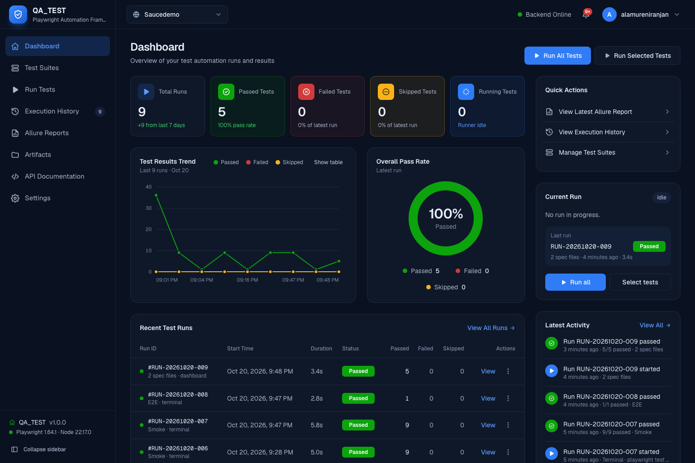
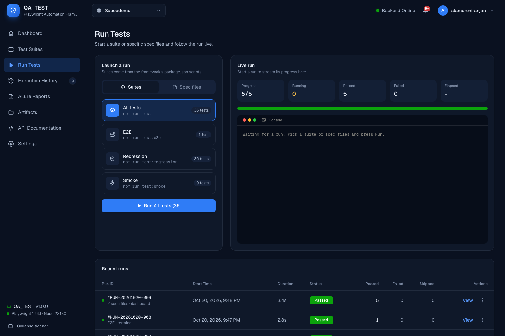

# QA_TEST Dashboard

A local admin panel, built with Next.js, for the Playwright framework in the parent folder. It launches suites or individual spec files and follows them live, and it keeps every run in a backend store with per-test results. Nothing in the UI is hard-coded: suites, tests, the environment and all numbers come from the framework and the store.



## Pages

| Page | What it shows |
|---|---|
| **Dashboard** (`/`) | KPI cards (total runs, passed, failed, skipped, running now), results trend, pass-rate donut, recent runs with View and actions, Quick Actions, Current Run (live test, step, URL, progress, Stop), Latest Activity, and links to the other sections |
| **Test Suites** (`/suites`) | Suites discovered from `package.json` with their last result; every spec file with tags and latest result; tick files to run them; results by feature; the latest results explorer |
| **Web Testing** (`/runs`) | **Launch a run** (suite or spec files) with **Browsers** below it (Chrome, Firefox, WebKit and a Browser size dropdown). On the right: one live frame in a desktop browser window, following the newest test or the one picked in *Watching*; then live progress and logs. When a run finishes, a notification links straight to it in Execution History. |
| **Responsive Testing** (`/responsive`) | The same launcher for emulated iPhone, Android Phone, iPad and Android Tablet models (from the framework's catalog). The live frame is a realistic phone/tablet with status bar, Dynamic Island or camera, and zoom. |
| **Execution History** (`/history`) | Stored runs with stats, the browsers and devices each run used (icon, name and version, e.g. Chrome v155, or iPhone 17 Pro · iOS 18.7 · WebKit 27.2), trend, filters (outcome, suite, source, run ID), JSON export, clearing history, and the activity log |
| **Allure Reports** (`/reports`) | A table of every run's own Allure report, with the browsers and devices (and their versions) it ran on, generated automatically when the run finishes, passed or failed, from the dashboard or a terminal (kept for the last 20 runs, with their media). Filter by outcome or search; click a row to preview its report below, or open it in a new tab. The latest Playwright HTML report is linked at the top. |
| **Artifacts** (`/artifacts`) | Screenshots, videos and traces of the latest run or any stored run (Run dropdown), filterable by folder and type; delete one file, a selection, or everything shown (results are kept). Screenshots and videos appear inside the phone/tablet or browser frame they were recorded in, here and in run details |
| **API Documentation** (`/api-docs`) | Every backend endpoint, with a live **Try it** button for read-only ones |
| **Settings** (`/settings`) | Theme, backend health, framework and project configuration, storage |

In every runs table, tick rows (or the header box to select all shown) and use **Delete selected** or **Delete all shown**; on Allure Reports the same buttons delete only the reports and keep the runs. Click a row (or press Enter on it) to open the run: per-test results, and each failed test's screenshot and video. The ⋮ menu offers **View**, **Re-run** and **Delete** (with confirmation; deleted runs are not recorded again).

Every dropdown is one shared component: filters use `Select` (Folder, Tag, Sort, Suite, Source), row actions use `ActionMenu`, and the project, notification and account panels use `Dropdown`. A **Folder** dropdown, built from the spec-file folders Playwright lists, appears on the Dashboard (scoping the KPIs, trend, pass rate and recent runs), Test Suites, the Tests explorer, Run Selected Tests and Artifacts.

The top bar shows the project (derived from the base URL), backend health, notifications (the activity feed) and the account menu (OS user, theme). Dark navy is the default theme; light and system themes are available.



## Where the data comes from

| Data | Source |
|---|---|
| Suites | `test` and `test:*` scripts in the framework's `package.json` that run `playwright test` with at most `--grep <pattern>` |
| Spec files, tests, tags, browsers, base URL, workers | `playwright test --list` with `reporters/catalog-reporter.ts` (cached for a minute) |
| Latest results | `test-results/results.json` (JSON reporter) |
| Live progress (running tests, step, last URL, counts) | `test-results/live.json`, written by `reporters/live-reporter.ts` during every run, including runs started from a terminal |
| Run history, per-test results, activity | Backend store `.dashboard/store.json` (git-ignored, last 100 runs) |
| Screenshots and videos per run | Copied from `test-results/` into `.dashboard/artifacts/<RUN-ID>/` when the run is recorded; kept for the last 20 runs (`ARTIFACT_RUNS_KEPT`) |
| Project name, version, user | Framework `package.json`, base URL host, OS user |

Every finished run gets an ID such as `RUN-20261020-007` and is stored once. The dashboard records which suite ran: from its own launch, or for terminal runs by matching the Playwright arguments to a `package.json` script. Live step labels show the action and its target (for example `Click getByTestId('login-button')`), never typed values.

## Getting started

From the framework root:

```bash
npm run dashboard:install   # once
npm run dashboard           # http://127.0.0.1:3000
```

Or from this folder: `npm ci` then `npm run dev`. For a production build: `npm run build && npm start`.

The dashboard also shows runs started from the terminal (`npm test` in the framework). It reloads results every 15 seconds.

## Hosted on Vercel (tests on GitHub Actions)

Vercel can't launch browsers or keep files, so the hosted dashboard works differently from the local one:

| | Local (`npm run dashboard`) | Hosted (Vercel) |
|---|---|---|
| Where tests run | This machine | GitHub Actions (`.github/workflows/e2e.yml`) |
| Starting a run | Runs Playwright directly | **Run** dispatches the workflow through the GitHub API |
| Run log | Playwright's output, live | Each workflow step as it starts and ends, plus a link to the GitHub run |
| Live preview | Yes | No |
| History, media, Allure reports | `.dashboard/` on disk | Vercel Blob, written by the workflow's publish step |

The workflow runs on every push to `main` and when the dashboard dispatches it. After the tests it runs `npm run publish:run` (in `dashboard/`), which uses the same ingest code as the local dashboard to publish the test catalog, the run, failed tests' screenshots and videos, and a single-file Allure report.

Cloud mode switches on only on Vercel or in GitHub Actions, when `BLOB_READ_WRITE_TOKEN` is set, so a token pulled into `.env.local` never changes the local dashboard.

**Vercel project** (Root Directory: `dashboard`), environment variables:

| Variable | Value |
|---|---|
| `BLOB_READ_WRITE_TOKEN` | Set automatically when a **public** Blob store is connected to the project |
| `GITHUB_REPOSITORY` | `owner/repo`, e.g. `alaniranjan/playwright-saucedemo-framework` |
| `GITHUB_TOKEN` | Fine-grained personal access token for that repository with **Actions: Read and write** (to start, follow and cancel runs) |
| `DASHBOARD_PASSWORD` | Protects every page and API with a browser login (user `admin`, or `DASHBOARD_USER`). Strongly recommended: without it anyone with the URL can start runs |
| `GITHUB_WORKFLOW_FILE`, `GITHUB_BRANCH` | Optional; default `e2e.yml` and `main` |

**GitHub repository secret:** `BLOB_READ_WRITE_TOKEN`, the same value as on Vercel. Until it is set, the workflow still runs the tests but skips publishing.

## API

The API Documentation page lists every endpoint, generated from `src/lib/api-docs.ts`:

| Route | Purpose |
|---|---|
| `GET /api/results` | Latest results, stored runs, activity, catalog and framework metadata |
| `GET /api/run` / `POST /api/run` / `DELETE /api/run` | Live state; start `{ "suite": "test:smoke" }` or `{ "files": [...] }`; cancel |
| `GET /api/runs` / `DELETE /api/runs` | Stored runs (`?download=1` for the full store); clear history |
| `GET /api/runs/{id}` | One run with per-test results (`?download=1` to download) |
| `GET /api/runs/{id}/report/` | That run's Allure report |
| `DELETE /api/runs` `{ids}` / `DELETE /api/run-reports` `{ids}` | Delete chosen runs (with media and reports) / only their reports |
| `GET /api/artifacts?path=` | A test attachment from `test-results/` |
| `GET /api/reports/{allure,playwright}/...` | Generated HTML reports |
| `GET /api/health` | Backend health for the "Backend Online" indicator |

## Security

This is a local developer tool that can start processes on your machine.

- `npm run dev` and `npm start` bind to `127.0.0.1` only, so other machines on your network can't reach it. Don't expose it publicly without adding authentication.
- `POST` and `DELETE` requests are rejected unless the `Origin` header matches the host. This stops other websites from starting runs through your browser.
- Runs are limited to the fixed npm scripts listed above. User input never reaches a shell.
- File routes resolve paths inside `test-results/` or the report folders only, so paths like `../` return 404.

## Tech

Next.js 16 (App Router, route groups, Route Handlers, Cache Components), React 19, Tailwind CSS 4 with design tokens and a custom `collapsed:` variant in `src/app/globals.css`, [Headless UI](https://headlessui.com/) for dropdowns, menus, popovers and dialogs (`src/components/dropdowns.tsx`, `src/components/ui.tsx`: keyboard navigation, focus management and anchored positioning), and hand-built SVG charts and icons.

```text
src/
├── app/
│   ├── (dashboard)/        # Route group sharing the admin shell
│   │   ├── layout.tsx      # Sidebar + top bar (AppShell)
│   │   ├── page.tsx        # Dashboard
│   │   ├── runs/           # Test runs
│   │   ├── history/        # Test history
│   │   ├── tests/          # Test explorer
│   │   └── reports/        # Reports
│   ├── api/                # results, run, artifacts, reports route handlers
│   ├── globals.css         # Light/dark design tokens, sidebar tokens, animations
│   └── layout.tsx          # Root HTML, fonts, pre-paint theme and sidebar state
├── components/
│   ├── shell/              # AppShell, Sidebar, Topbar
│   ├── pages/              # One client component per page
│   ├── providers/          # DashboardProvider: shared polling of results and run state
│   └── ...                 # Charts, tables, cards, launcher, live run card
└── lib/
    ├── server/             # Report parsing, history, suite catalog, process runner, path guards
    ├── types.ts            # Shapes shared by the API and the UI
    ├── progress.ts         # Live progress from Playwright's list output
    └── format.ts
```
